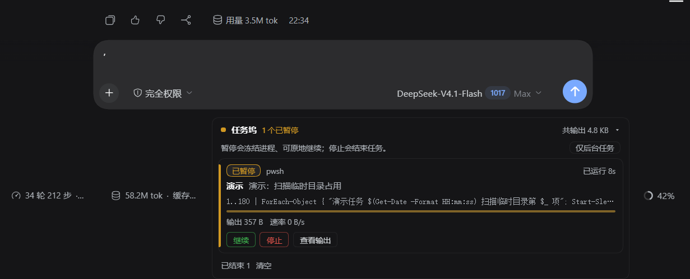

# 任务坞 · Task Dock

> DeepSeek Harness 的后台任务面板：看得见进度，按得下暂停，停得掉任务，失败有原因。

任务坞是一个 [DeepSeek Harness](https://github.com/deepseek-ai)（DSH）Web 界面的插件，把当前会话里所有后台任务集中显示在输入框下方，并提供**真正的暂停/继续**——冻结进程而不是杀掉它，恢复后从断点继续，任务不会因此损坏。

---

## 为什么需要它

DSH 已经能把一条命令放到后台运行，但原生界面只能：列出任务、看输出、停止。缺少三件最常用的事：

1. **暂停**：临时让出 CPU/磁盘，稍后继续，而不是只能杀掉重跑；
2. **进度感**：不知道任务是在干活还是卡住了；
3. **可读性**：任务名只有一长串命令，失败只有一个退出码。

任务坞补齐了这三点，并且**不改变任务本身的行为**。

---

## 功能特性

| 能力 | 说明 |
| --- | --- |
| 任务列表 | 状态、类型、已运行时长，每秒刷新 |
| 进度与吞吐 | 输出字节数、输出速率（B/s）、进度条 |
| 实时输出 | 展开查看输出尾部，自动滚到最新，丢弃的片段会提示 |
| **暂停 / 继续** | 一键冻结进程树，一键原地恢复，无确认弹窗、不丢数据 |
| 停止 | 两段式确认，避免误杀；暂停状态下同样可用 |
| 失败诊断 | 非零退出码标红，直接显示原因与最后一行输出 |
| 人类可读任务名 | `短名 + 说明`，不显示任务 ID；无描述时自动生成短名 |
| 后台/全部过滤 | 默认只显示后台任务，避免误停 agent 正在等待的前台命令 |
| 状态配色 | 运行/完成绿色、暂停琥珀、失败红色、取消灰色 |

---

## 截图



真实界面：一个被暂停的任务（琥珀色「已暂停」）、任务短名与说明、输出量与输出速率、`暂停/继续`、`停止`、`查看输出`，以及下方「已结束」分组与「仅后台任务」过滤。

---

## 环境要求

- DeepSeek Harness `0.2.1-rc.2`（开发与验证版本）
- 需要 Web 界面（桌面版或 `dsh web`）
- **暂停/继续仅支持 Windows**（其他平台面板可用，暂停按钮会提示不支持）
- 无需 Node 构建步骤、无 npm 依赖、无原生模块

---

## 安装

任务坞按 DSH 的 **bundle（插件包）** 形式分发：一个 `package.json` + 一个 `cordis.patch.yml` + 两个 JS 文件。

### 方式 A：本地目录安装（推荐）

1. 克隆或下载本仓库到本地，任意目录；
2. 在 DSH Web 界面进入 **设置 → 插件**，选择“从本地目录安装”，指向本仓库根目录；
3. 重启 DeepSeek Harness（Host 半是 Node 模块，新增或替换后必须重启才会加载）；
4. 刷新页面，面板会在有后台任务时出现在输入框下方。

也可以让 agent 代为安装：工具 `plugin_manager` 的 `install_bundle`，`target` 填本仓库的**绝对路径**。

### 方式 A2：Git 仓库地址安装

DSH 的「添加插件」对话框同样接受 Git 仓库地址。把本仓库推送到 GitHub / Gitee 后，用户可以直接粘贴：

```text
https://gitee.com/mercury-project/task-dock
```

DSH 会用 pnpm 克隆该仓库并安装。这种方式得到的是**副本**：升级需要先卸载再装新版（也可以在地址后加 `#<commit>` 固定版本）。本仓库的包即在根目录，不需要子目录路径。

> 本仓库的 `package.json` 带 `"private": true`。它只阻止发布到 npm，**不影响**目录安装与 Git 地址安装。

### 方式 B：作为 profile 依赖

把仓库放进你的 profile 依赖中（等价于 `install_bundle` 的结果），由 DSH 的 Loader 加载 `include:background-jobs-panel` 这一行。

> 不建议手工修改 profile 的 `package.json` 或 `node_modules`；请优先使用方式 A。

### 方式 C：npm 包（需维护者发布后）

本仓库当前包名 `@local/background-jobs-panel` 中的 `@local` 不能发布到 npm。维护者按
[PUBLISHING.md](PUBLISHING.md) 改名并发布后，用户可以：

- **设置 → 插件 → 安装**，输入包名（如 `@mercury-project/dsh-task-dock`）；
- 或让 agent 执行 `plugin_manager`：`install_bundle`，`target` 填 `@mercury-project/dsh-task-dock@1.1.0`。

### 方式 D：插件市场（Discover）

本仓库提供官方 **format 1** 的市场索引：[`market/index.json`](market/index.json)（已通过 DSH 的
`parseMarketIndex` 校验）。

索引地址：

```text
https://gitee.com/mercury-project/task-dock/raw/main/market/index.json
```

> **当前不可用（2026-10）**：DSH 的市场功能在 npm 上只有实验性 `0.2.1-alpha.4` bundle，
> 与稳定版核心 `0.2.1-rc.2` 的依赖树不兼容，Host 半无法挂载，Discover 页没有数据。
> 这是上游打包问题，与本索引无关。等上游发布 rc.2 市场 bundle 后，按
> [market/README.md](market/README.md) 的步骤添加索引即可，无需改本仓库。

配置步骤（上游修好后）：

1. 安装市场 bundle `@deepseek-ai/dsh-experimental-plugin-market-bundle`，重启 Harness；
2. **设置 → 插件 → Discover** → 添加上面的索引地址；
3. 在列表中点「任务坞」安装，再重启。

### 方式对比

| 方式 | 用户操作 | 需要维护者发布 | 升级方式 |
| --- | --- | --- | --- |
| A 本地目录 | 选目录安装 | 否 | `git pull` 后重启 |
| B profile 依赖 | 写进依赖 | 否 | 重装/升级依赖 |
| C npm 包 | 填包名 | 是（改包名后发布） | 重装新版本 |
| D 插件市场 | 添加索引后点击安装 | 是 | 市场内更新 |

### 安装后验证

- **设置 → 插件** 中应出现「任务坞 / Task Dock」；
- 让 agent 执行一条 `run_in_background` 命令，输入框下方出现面板；
- 面板标题为「任务坞」。

---

## 使用

### 面板位置

当前会话输入框**正下方**。没有任何任务时完全隐藏，不占位。

### 每一行

```text
● 运行中                              已运行 3:12
清理软件  删除 X 的安装目录与注册表残留
Get-ChildItem … | Remove-Item …        ← 灰色等宽小字，实际命令
[输出 24.6 KB] [速率 1.2 KB/s]
[暂停] [停止] [查看输出]
```

- **短名**：加粗显示；**说明**：灰色；两者都来自 agent 执行命令时写的 `description`。
- 命名约定：描述写成 `短名：详细说明`，面板会把冒号前作为短名。
- 没有描述的旧任务会自动取命令的前几个字/词作为短名。

### 按钮

| 按钮 | 行为 |
| --- | --- |
| 暂停 | 一键冻结该任务的进程树。计时停止、速率归零、状态变琥珀色 |
| 继续 | 一键恢复。从冻结处继续执行，不丢失任何输出 |
| 停止 | 需要点两次确认（3 秒内第二次生效），真正终止任务 |
| 查看输出 | 展开/收起实时输出尾部 |

### 过滤

面板右上角胶囊按钮：

- **仅后台任务**（默认）：只显示已确认的后台任务；未识别的命令会被隐藏，头部显示“已隐藏 N 条”；
- **显示全部**：显示当前会话的所有命令，包括 agent 正在前台等待的命令。

选择会保存在浏览器本地存储中。

---

## 暂停是如何实现的

DSH 的任务接口（`ctx.jobs`）只提供列举、读取、终止，没有暂停。任务坞用**操作系统层面的进程冻结**实现暂停：

1. 通过任务 ID 取到该任务注册时的命令行与开始时间（Host 侧 `ctx.jobs`）；
2. 在宿主进程的**直接子进程**中，按“命令行包含该命令 + 启动时间接近”定位这次执行；
3. 用 `NtSuspendProcess` 冻结目标进程及其全部后代；继续时用 `NtResumeProcess` 恢复。

### 安全性设计

- **定位失败就不动**：找不到或多条同名任务无法消歧时，返回明确原因，绝不猜测；
- **只匹配宿主直接子进程**：不会误冻系统里同名的其它进程；
- **冻结不破坏状态**：内存、文件句柄、游标、位置全部保留，恢复后继续；
- **暂停时仍可停止**：停止走 DSH 原有终止路径，能结束被冻结的任务；
- **关闭 Harness 自动恢复**：插件销毁时会把所有被冻结的任务恢复，不留“冻死”的进程。

### 已知限制

- 仅 Windows；每次暂停/继续会启动一个 Windows PowerShell 辅助进程，约 2–3 秒延迟；
- 被冻结的进程仍占用内存与句柄，且可能持有锁/连接；长时间暂停网络类任务可能超时；
- 依赖 DSH 内部的进程树形态。若 DSH 升级后暂停提示“未能定位进程”，说明匹配规则需要更新；
- 暂停状态保存在 Host 内存，Harness 重启后不保留（重启时任务本就会被终止/恢复）。

---

## 安全说明

- 浏览器半通过同源 HTTP 路由 `POST /bgjp/control` 与 Host 半通信；
- 路由**拒绝跨源请求**（校验 `Origin` 与 `Host`），因此其它网页无法调用；
- 本机进程（已具备直接控制进程能力）无 `Origin` 头时可以调用；该接口只能**冻结/恢复已存在的任务**，不能执行任意命令、不能读写文件；
- 插件不联网、不上传任何数据，所有信息留在本机。

---

## 目录结构

```text
task-dock/
├── package.json        # bundle 清单：exports、dsh.bundle、dsh.client
├── cordis.patch.yml    # Loader 补丁：插入 background-jobs-panel 行
├── index.js            # Host 半：控制通道、任务命名采集、冻结/恢复
├── client.js           # 浏览器半：面板 UI 与交互
├── locale/
│   ├── zh.json         # 插件页展示元数据（中文）
│   └── en.json         # 插件页展示元数据（英文）
├── icon.svg            # 原创图标
├── README.md
├── CHANGELOG.md
├── CONTRIBUTING.md
├── SECURITY.md
├── LICENSE
└── .gitignore
```

---

## 开发与调试

本项目是**纯 JavaScript、无构建**的 DSH bundle。

```bash
# 语法检查（任选其一）
node --check index.js
node --check client.js
```

- 改 `client.js` 后**刷新页面**即可生效（浏览器半随页面加载）；
- 改 `index.js`（Host 半）后必须**重启 DeepSeek Harness**；
- 面板调试日志：DSH 主进程日志中搜索 `background-jobs-panel`。

### 兼容性

已在 Windows + DSH `0.2.1-rc.2` 实测：

- 列表 / 进度 / 速率 / 实时输出 / 停止；
- 暂停 → 继续（冻结 5–8 秒，输出零丢行、进程号不变）；
- 非零退出码标红并显示原因；
- 暂停状态下停止。

依赖的 DSH 内部能力：`ctx.jobs`、`tools/result` 事件、`ctx.webServer`。DSH 升级后若这些接口变化，需要相应调整。

---

## 贡献

欢迎 issue 与 PR。请先阅读 [CONTRIBUTING.md](CONTRIBUTING.md) 与 [SECURITY.md](SECURITY.md)。

## 许可证

[MIT](LICENSE) © 2026 Task Dock contributors

## 致谢

- [DeepSeek Harness](https://github.com/deepseek-ai) 提供的插件体系与 Web 界面；
- 所有提交 issue、反馈真实使用场景的用户。

---

## English summary

**Task Dock** is a DeepSeek Harness Web UI plugin that turns the session's background jobs into a readable panel under the composer: status, elapsed time, output size/rate, live output tail, human-readable task names, failure reasons, one-click **pause/resume**, and a guarded **stop**.

Pausing freezes the job's process tree (`NtSuspendProcess`) and resuming continues in place (`NtResumeProcess`) — nothing is signalled, killed or restarted, so a paused task is never corrupted. Process matching is conservative: if the target cannot be identified unambiguously, the action is refused rather than guessed.

- Windows only for pause/resume; the panel itself is platform-neutral.
- No build step, no npm dependencies, no native modules.
- MIT licensed.
